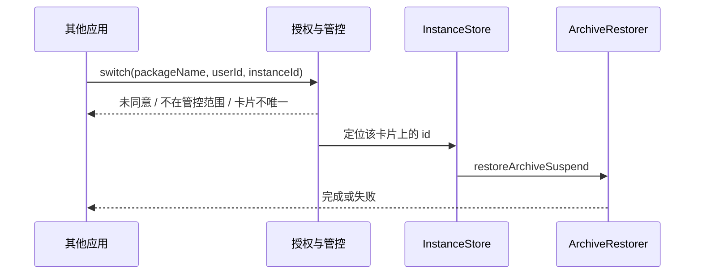

# 固定实例

> 版本：v1.0 · 日期：2026-10-23 · 状态：draft
>
> 应用内实例已落地。对外 SDK、MCP、AppFunction 尚未实现。

## 文档索引

| 章节 | 内容 |
|------|------|
| 1 | [背景与目标](#背景与目标) |
| 2 | [现状分析](#现状分析) |
| 3 | [功能设计](#功能设计) |
| 4 | [核心业务逻辑](#核心业务逻辑) |
| 5 | [对外 SDK](#对外-sdk) |
| 6 | [模块与文件结构](#模块与文件结构) |
| 7 | [边界与质量](#边界与质量) |
| 8 | [实施计划](#实施计划) |

## 快速摘要

固定实例是一份带名称和账号的锁定备份，目录以 id 命名，每个 id 只保留这一份。它不进入普通存档列表，保留策略不会清理它。其他应用要通过公开的 Service/Provider 切换目标应用的实例，必须先在本应用内打开服务并同意调用方；目标应用可以是全部已建卡应用，或一张白名单。MCP 与 AppFunction 走同一套开关和授权，不另开门。

## 阅读建议

| 角色 | 建议阅读顺序 |
|------|--------------|
| 产品/评审 | 背景与目标 → 功能设计 → 对外 SDK → 验收标准 |
| 开发 | 现状分析 → 核心业务逻辑 → 对外 SDK → 文件结构 |
| 测试 | 边界与质量 → 验收标准 |

---

## 背景与目标

### 需求背景

普通存档按时间保留多份，用于回溯。固定实例是另一层：一个实例对应一个账号的一份数据，更新时替换这一份，而不是再留一条历史。其他应用（包括本机上的账号管理器）需要在不拿到 Root、不读备份目录的前提下，切换某个目标应用的实例。

### 目标

- 写明实例的目录、身份和「一个 id 一份备份」。
- 应用内可以创建、更新、编辑资料、恢复、删除实例。
- 提供公开的 Service/Provider SDK，供其他应用列出并切换目标应用的实例。
- SDK 默认关闭。调用方必须在本应用内被同意后才能调用。
- 管控目标应用的范围可选「全部」或「白名单」。
- 同一套授权下预留 MCP server 与 Android AppFunction。

### 非目标

- 不修改普通快照、恢复、锁定、清空存档和保留策略的行为。
- 不把 HarnessManager 或其他调用方的号库写进实例目录。账号字段只是用户填写的文本。
- 不对外暴露 Root、文件路径、任意命令或备份文件内容。
- 不在切换时自动把当前正在用的数据写回上一个实例。要留下当前数据，调用方必须先更新对应实例。
- 第一版 SDK 不提供跨用户恢复。`userId` 必须和实例所在分组一致。

## 现状分析

应用内实例已经落在 `app/.../instance/`。备份和恢复分别调用现有的 `ArchiveMaker.makeSnapshot` 与 `ArchiveRestorer.restoreArchiveSuspend`，不改这两条实现。存档列表加载时跳过名为 `instances` 的目录，避免把它当成坏存档。

一个应用卡片的实例放在该卡片的 `packageDir` 下。同一包名出现在多张卡片时，各有各的 `packageDir`，实例不共享。

对外还没有任何 exported Service 或 Provider。Manifest 里只有启动 Activity 是 exported。

## 功能设计

### 信息架构

应用内入口保持在存档页长按卡片的「实例」。设置里另加「对外实例服务」，和实例编辑分开：

- 总开关。关闭时，SDK、MCP、AppFunction 一律拒绝。
- 调用方：包名、签名证书摘要、同意或撤销。
- 管控范围：全部，或白名单。白名单是目标应用包名列表。
- MCP：仅本机回环。打开后显示一次访问令牌。
- AppFunction：跟随总开关，不单独绕过调用方同意。

### 交互设计

应用内：

1. 新建：先填名称、账号、备注，再备份当前应用到新的 `{id}`。
2. 更新备份：用当前应用数据替换该 id 的那一份。名称和账号不变。
3. 编辑资料：只改 `instance.json`。
4. 恢复：用该 id 的备份覆盖应用当前数据。不自动更新其他实例。
5. 删除：删除该 id 目录。这是删除这份备份的唯一入口。

其他应用：

1. 绑定服务或查询 Provider。未同意则得到 `CONSENT_REQUIRED`。
2. 用户在本应用里同意该调用方。
3. 调用方列出某个目标包的实例，再按 id 切换。目标不在管控范围内时得到 `APP_NOT_MANAGED`。

## 核心业务逻辑

### 数据模型

```
{packageDir}/instances/{id}/
    instance.json       # id、名称、账号、备注、创建时间、更新时间
    meta-info.json      # 这一份备份的清单
    …                   # 同一次快照拆出的数据文件
```

- 目录名是 id，不是名称。id 匹配 `^[A-Za-z0-9_-]{1,64}$`，由本应用生成。
- 每个 id 只保留一份备份。更新是整目录替换，不在 id 下再留时间戳子目录。
- `{id}.committing` 与 `{id}.previous` 只在替换过程中出现。操作结束或下次列出时收成一个 `{id}`：正式目录在就删掉临时副本；正式目录不在就从临时目录恢复那一份。
- 名称在同一张卡片内唯一。非空账号也唯一。账号可空。
- 实例元数据不进入普通存档的保留策略。共享 APK 仍在 `{packageDir}/apks/`，这是现有快照的去重位置；SDK 设计不改变这条规则，但实现对外切换前要保证删普通存档不会拆掉仍被实例引用的 APK。

对外授权存在应用私有配置，不放进可同步的快照目录：

| 项 | 含义 |
|----|------|
| `enabled` | 对外服务总开关，默认关 |
| `callerGrants` | 已同意的调用方：包名 + 证书 SHA-256 |
| `targetMode` | `all` 或 `whitelist` |
| `targetPackages` | `whitelist` 时允许被管控的包名 |
| `mcpTokenHash` | MCP 令牌的哈希。明文只在打开或轮换时显示一次 |

### 查询逻辑

应用内列出当前卡片的实例。

对外列出时，先过授权和管控范围，再按 `(packageName, userId)` 找卡片：

- 没有卡片：`APP_NOT_IN_GROUP`。
- 多张卡片：必须额外传入本应用的 `groupId`，否则 `AMBIGUOUS_CARD`。不把 `packageDir` 交给调用方。
- `targetMode = all`：凡是已加入分组的应用都可被列出和切换。
- `targetMode = whitelist`：包名还必须在白名单里。

### 操作流程

切换就是对该 id 调用现有恢复。当前正在使用的数据不会自动写回别的实例。



创建和更新会跑完整份快照，可能耗时数分钟。Binder 调用只登记操作并返回 `operationId`，进度用回调或后续查询，不占住 Binder 线程直到结束。

## 对外 SDK

SDK 是一个独立的小模块，只含 AIDL、请求/结果类型和绑定帮助类。调用方依赖这个模块，不依赖 `app` 或 `provider`。

### Service 与 Provider

| 入口 | 职责 |
|------|------|
| `InstanceControlService` | 导出的绑定服务。切换、创建、更新、删除，以及长操作的进度 |
| `InstanceProvider` | 导出的 ContentProvider，只读。列出实例、读一份实例的名称和账号 |

两者都 `exported`，并声明同一个签名级之外的普通权限 `tiiehenry.android.app.snapshot.permission.CONTROL_INSTANCES`。系统权限只证明调用方声明过它。真正能否调用，由本应用内的同意名单决定。权限和同意缺一不可。

建议的 AIDL 能力：

| 方法 | 作用 |
|------|------|
| `listInstances` | 列出目标应用在某 `userId` 下的实例 id、名称、账号、更新时间 |
| `switchInstance` | 用该 id 的备份恢复目标应用 |
| `createInstance` | 先提交名称、账号、备注，再备份当前数据 |
| `updateInstance` | 用当前数据替换该 id 的备份 |
| `deleteInstance` | 删除该 id 及其唯一备份 |

Provider 只实现 `listInstances` 对应的查询。写操作只走 Service。

调用结果使用稳定错误码：`CONSENT_REQUIRED`、`SERVICE_DISABLED`、`APP_NOT_MANAGED`、`APP_NOT_IN_GROUP`、`AMBIGUOUS_CARD`、`INSTANCE_NOT_FOUND`、`BUSY`、`FAILED`。不返回内部路径和异常栈。

### 应用内同意

- 总开关关闭时，任何外部调用都是 `SERVICE_DISABLED`。
- 调用方第一次被拒绝后，本应用的「对外实例服务」里出现待处理项：包名和证书摘要。用户点同意后，该调用方才能成功。
- 同意绑定的是包名加证书 SHA-256。证书变了要重新同意。
- 撤销立即生效，不等进程重启。
- 同意名单可清空。清空后效果与总开关打开但无人被同意相同。

### 管控的应用列表

| 模式 | 行为 |
|------|------|
| 全部 | 已加入任意分组的应用都可被外部列出和切换 |
| 白名单 | 只有名单里的包名可以。名单从已加入分组的应用中选择 |

白名单为空时，外部调用全部得到 `APP_NOT_MANAGED`。应用内的实例页面不受这个开关影响，用户自己始终可以管理已建卡应用的实例。

### MCP server

MCP 是上述 Service 的另一扇门，不是另一套数据。

- 只监听 `127.0.0.1`，不监听局域网。
- 工具与 AIDL 对齐：`list_instances`、`switch_instance`、`create_instance`、`update_instance`、`delete_instance`。
- 请求必须带本应用签发的令牌。令牌只以哈希保存，轮换后旧令牌立即失效。
- 总开关、调用方同意、目标应用范围同样生效。MCP 客户端若没有对应的已同意调用方身份，即使持有令牌也拒绝。令牌代表「这台机器上的本应用允许本机自动化」，调用方身份仍要记在同意名单里；本机 MCP 客户端使用单独的内置调用方条目，由用户在打开 MCP 时一并同意。

### AppFunction

使用 AndroidX AppFunctions，把 `listInstances` 与 `switchInstance` 暴露给系统可发现的应用函数。创建、更新、删除是否暴露，跟 SDK 的写操作一起在后续阶段决定。

- 跟随总开关。关闭服务时不对外声明可用，或调用时返回不可用。
- 仍检查调用方是否已在本应用内同意。平台若不能给出调用方包名和证书，该次 AppFunction 调用拒绝。
- 不因为调用来自系统就跳过白名单。

## 模块与文件结构

| 路径 | 操作 | 说明 |
|------|------|------|
| `app/.../instance/` | 已新增 | 应用内实例。SDK 只调用这里，不复制备份逻辑 |
| `instance-sdk/` | 待新增 | 公开 AIDL 与客户端绑定帮助类 |
| `app/.../external/InstanceControlService.kt` | 待新增 | 授权、管控范围、把调用转到 `InstanceStore` |
| `app/.../external/InstanceProvider.kt` | 待新增 | 只读查询 |
| `app/.../external/ExternalAccessConfig.kt` | 待新增 | 总开关、调用方同意、全部/白名单 |
| `app/.../external/McpInstanceServer.kt` | 待新增 | 回环 MCP |
| `app/.../external/InstanceAppFunctionService.kt` | 待新增 | AppFunction |
| 设置页 | 待新增 | 总开关、调用方、管控范围、MCP 令牌 |

现有 `ArchiveMaker`、`ArchiveRestorer`、保留策略和清空存档不在本设计的修改范围内。

## 边界与质量

### 边界情况

- 同一包名多张卡片：不猜卡片，返回 `AMBIGUOUS_CARD`。
- 目标应用未安装：创建、更新、切换失败。编辑资料和删除仍可进行。
- 实例正在备份或恢复：同一 `packageDir` 上的外部调用返回 `BUSY`。
- 切换失败时不自动回滚到另一个实例。当前数据可能已经按现有恢复流程被清过；调用方要有自己的重试。本设计不在外部切换里增加自动回滚，以免改变现有恢复语义。
- 分组「备份后卸载」对普通快照仍生效。实例备份不执行这条卸载任务。
- 调用方进程死亡：已开始的长操作继续做完，结果可按 `operationId` 再查。

### 性能方案

- 列出实例只读 `instance.json`，不扫描压缩包内容。
- 切换和更新复用现有快照管线。大应用耗时与普通备份相同，接口用异步操作表达。

### 测试范围

- 目录收成：成功更新后只剩 `{id}`；失败后仍是原来的那一份。
- 总开关、未同意、证书变化、撤销。
- `all` 与白名单，包括空白名单和未入组的包名。
- 多卡片必须带 `groupId`。
- Provider 不能执行写操作。
- MCP 拒绝非回环连接和错误令牌。
- AppFunction 在无法识别调用方时拒绝。
- 普通快照、恢复、保留策略的现有测试保持通过。

## 实施计划

### Phase 1: 应用内实例

- [x] `{packageDir}/instances/{id}/`，每个 id 一份备份
- [x] 创建、更新、编辑、恢复、删除
- [ ] 删普通存档时保留仍被实例引用的共享 APK

### Phase 2: 授权与 SDK

- [ ] 总开关、调用方同意、全部/白名单
- [ ] `instance-sdk` 的 AIDL、Service 与只读 Provider
- [ ] `listInstances` 与 `switchInstance`

### Phase 3: 写操作

- [ ] SDK 上的创建、更新、删除，以及 `operationId` 进度

### Phase 4: MCP 与 AppFunction

- [ ] 回环 MCP
- [ ] AppFunction 的列出与切换

### 验收标准

- [ ] `instances` 下长期只存在以 id 命名的目录，每个目录只有一份备份
- [ ] 普通存档的保留策略不删除实例目录
- [ ] 外部调用在总开关关闭或调用方未同意时失败
- [ ] 白名单之外的目标应用不能被外部列出或切换
- [ ] 调用方拿不到备份路径和 Root
- [ ] MCP 与 AppFunction 不能绕过上述开关、同意和白名单
