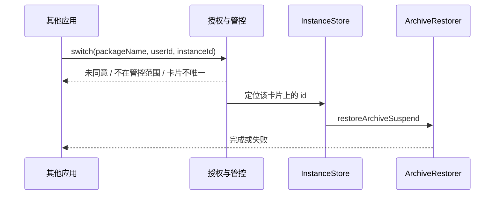

# 固定实例

> 版本：v1.1 · 日期：2026-10-24 · 状态：draft
>
> 应用内实例、对外 Service、只读 Provider、应用内同意、全部/白名单和本机 MCP 已落地。AppFunction 尚未实现，Manifest 也不再声明空壳 Service。长操作进度和调用方证书的真机联调仍待做。

## 文档索引

| 章节 | 内容 |
|------|------|
| 1 | [背景与目标](#背景与目标) |
| 2 | [现状分析](#现状分析) |
| 3 | [功能设计](#功能设计) |
| 4 | [核心业务逻辑](#核心业务逻辑) |
| 5 | [对外 SDK](#对外-sdk) |
| 6 | [模块与文件结构](#模块与文件结构) |
| 7 | [边界与质量](#边界与质量) |
| 8 | [实施计划](#实施计划) |

## 快速摘要

固定实例是一份带名称和账号的锁定备份，目录以 id 命名，每个 id 只保留这一份。它不进入普通存档列表，保留策略不会清理它。其他应用要通过公开的 Service/Provider 切换目标应用的实例，必须先在本应用内打开服务并同意调用方；目标应用可以是全部已建卡应用，或一张白名单。MCP 与 AppFunction 走同一套开关和授权，不另开门。

## 阅读建议

| 角色 | 建议阅读顺序 |
|------|--------------|
| 产品/评审 | 背景与目标 → 功能设计 → 对外 SDK → 验收标准 |
| 开发 | 现状分析 → 核心业务逻辑 → 对外 SDK → 文件结构 |
| 测试 | 边界与质量 → 验收标准 |

---

## 背景与目标

### 需求背景

普通存档按时间保留多份，用于回溯。固定实例是另一层：一个实例对应一个账号的一份数据，更新时替换这一份，而不是再留一条历史。其他应用（包括本机上的账号管理器）需要在不拿到 Root、不读备份目录的前提下，切换某个目标应用的实例。

### 目标

- 写明实例的目录、身份和「一个 id 一份备份」。
- 应用内可以创建、更新、编辑资料、恢复、删除实例。
- 提供公开的 Service/Provider SDK，供其他应用列出并切换目标应用的实例。
- SDK 默认关闭。调用方必须在本应用内被同意后才能调用。
- 管控目标应用的范围可选「全部」或「白名单」。
- 同一套授权下提供本机 MCP server，并为 Android AppFunction 预留同一门禁。

### 非目标

- 不修改普通快照、恢复、锁定、清空存档和保留策略的行为。
- 不把 HarnessManager 或其他调用方的号库写进实例目录。账号字段只是用户填写的文本。
- 不对外暴露 Root、文件路径、任意命令或备份文件内容。
- 不在切换时自动把当前正在用的数据写回上一个实例。要留下当前数据，调用方必须先更新对应实例。
- 第一版 SDK 不提供跨用户恢复。`userId` 必须和实例所在分组一致。

## 现状分析

应用内实例已经落在 `app/.../instance/`。备份和恢复分别调用现有的 `ArchiveMaker.makeSnapshot` 与 `ArchiveRestorer.restoreArchiveSuspend`，不改这两条实现。存档列表加载时跳过名为 `instances` 的目录，避免把它当成坏存档。

一个应用卡片的实例放在该卡片的 `packageDir` 下。同一包名出现在多张卡片时，各有各的 `packageDir`，实例不共享。

对外入口是 `InstanceControlService` 与只读 `InstanceProvider`，都要求调用方声明 `CONTROL_INSTANCES` 权限并通过应用内同意。`InstanceAppFunctionService` 曾在 Manifest 中声明但没有任何实现，已移除；AppFunction 仍是后续阶段。

## 功能设计

### 信息架构

应用内入口保持在存档页长按卡片的「实例」。设置里另加「对外实例服务」，和实例编辑分开：

- 总开关。关闭时，SDK、MCP、AppFunction 一律拒绝。
- 调用方：包名、签名证书摘要、同意或撤销。
- 管控范围：全部，或白名单。白名单是目标应用包名列表。
- MCP：仅本机回环。打开后显示一次访问令牌。
- AppFunction：尚未实现。接入时必须跟随总开关，不单独绕过调用方同意。

### 交互设计

应用内：

1. 新建：先填名称、账号、备注，再备份当前应用到新的 `{id}`。
2. 更新备份：用当前应用数据替换该 id 的那一份。名称和账号不变。
3. 编辑资料：只改 `instance.json`。
4. 恢复：用该 id 的备份覆盖应用当前数据。不自动更新其他实例。
5. 删除：删除该 id 目录。这是删除这份备份的唯一入口。

其他应用：

1. 绑定服务或查询 Provider。未同意则得到 `CONSENT_REQUIRED`。
2. 用户在本应用里同意该调用方。
3. 调用方列出某个目标包的实例，再按 id 切换。目标不在管控范围内时得到 `APP_NOT_MANAGED`。

## 核心业务逻辑

### 数据模型

```
{packageDir}/instances/{id}/
    instance.json       # id、名称、账号、备注、创建时间、更新时间
    meta-info.json      # 这一份备份的清单
    …                   # 同一次快照拆出的数据文件
```

- 目录名是 id，不是名称。id 匹配 `^[A-Za-z0-9_-]{1,64}$`，由本应用生成。
- 实例绑定在一张应用卡片上：`packageDir` 决定目标应用、用户和分组，不能换到另一张卡片。
- `account` 是给人看的账号名，同一张卡片里非空账号不能重复。
- `externalId` 是调用方的账号编号。HarnessManager 写成 `提供者/账号 id`，例如 `xai/acct-1`。同一张卡片里非空编号不能重复。调用方用 `bindInstance` 写入，用 `unbindInstance` 清空。这是绑定关系的来源，不从账号名字猜测。已绑定的实例只允许同一 `externalId` 的调用方改写或清空；别人按 `INSTANCE_NOT_FOUND` 处理，不暴露归属。`unbindInstance` 也必须在请求里带上当前 `externalId`，否则同样按 `INSTANCE_NOT_FOUND` 处理，不能凭实例 id 清掉别人的绑定。
- 账号类型和实例所在的应用分开设置。每种 Provider 在调用方自己的设置里指定一个 Android 包名。xAI 账号的实例可以是浏览器，也可以是官方客户端。AppSnapshoter 只认这个包名对应的应用卡片，不根据 Provider 猜应用。白名单管的是这些宿主应用。
- 应用内恢复、更新、删除都要先确认。外部 `switchInstance` 不直接覆盖数据，而是弹出本应用的确认页；用户点确认后才恢复。取消则不变。正在使用的数据不会自动写回别的实例。
- 每个 id 只保留一份备份。更新是整目录替换，不在 id 下再留时间戳子目录。
- `{id}.committing` 与 `{id}.previous` 只在替换过程中出现。操作结束或下次启动收成一个 `{id}`：正式目录在就删掉临时副本；正式目录不在就从 `.previous` / `.committing` 恢复那一份。
- `instance.json` 采用 `.tmp` 写入、旧文件转 `.bak`、再发布新文件的顺序。收成时先确认正式文件可解码；正式文件损坏则用 `.bak`，其次 `.tmp` 替换，只有最终元数据可读后才删除恢复副本。任何一步失败都保留副本，留给下一次受 `PackageOpGuard` 保护的收成重试。
- 清单读取分三种结果：就绪、确认不可用、读取未决。只有确认缺失或结构无效才算不可用；读取抛异常是未决，必须保留正式槽和 `.previous`，不能拿旁边的副本替换。发布时新槽已就位、只差删除 `.previous` 属于清理债务，可留到下次收成；替换来源的移动失败要让本次备份失败。
- 名称在同一张卡片内唯一。非空账号也唯一。账号可空。
- 实例元数据不进入普通存档的保留策略。共享 APK 仍在 `{packageDir}/apks/`，这是现有快照的去重位置；SDK 设计不改变这条规则，但实现对外切换前要保证删普通存档不会拆掉仍被实例引用的 APK。

对外授权存在应用私有配置，不放进可同步的快照目录：

| 项 | 含义 |
|----|------|
| `enabled` | 对外服务总开关，默认关 |
| `approved` | 已同意的调用方：包名 + 证书 SHA-256 |
| `pending` | 待用户同意的调用方 |
| `targetMode` | `all` 或 `whitelist` |
| `targetPackages` | `whitelist` 时允许被管控的包名 |
| `mcpEnabled` | MCP 子开关；总开关打开时仍须单独打开 |
| `mcpTokenHash` | MCP 令牌的哈希。明文只在打开或轮换时显示一次 |

### 查询逻辑

应用内列出当前卡片的实例。

对外列出时，先过授权和管控范围，再按 `(packageName, userId)` 找卡片：

- 没有卡片：`APP_NOT_IN_GROUP`。
- 多张卡片：必须额外传入本应用的 `groupId`，否则 `AMBIGUOUS_CARD`，响应带候选 `groups` 供调用方挑一个重试。不把 `packageDir` 交给调用方。
- `targetMode = all`：凡是已加入分组的应用都可被列出和切换。
- `targetMode = whitelist`：包名还必须在白名单里。

`listInstances` 只返回未绑定实例，以及 `externalId` 与本次请求相同的实例。响应里不出现其他绑定的 id、`externalId`、账号和备注。Provider 的 `externalId` 查询参数缺省为空，因此只列出未绑定实例。

### 操作流程

切换就是对该 id 调用现有恢复。当前正在使用的数据不会自动写回别的实例。确认通知和确认页都打不开时，本次操作立即成为 `error` / `FAILED`，待确认项被取走，调用方不会一直停在 `confirm`。确认页因配置变更重建时不写 `CANCELLED`。



创建和更新会跑完整份快照，可能耗时数分钟。Binder 调用只登记操作并返回 `operationId`，进度用回调或后续查询，不占住 Binder 线程直到结束。

## 对外 SDK

SDK 是一个独立的小模块，目前只含 AIDL 契约；请求/结果类型和客户端绑定帮助类尚未提供。调用方依赖这个模块，不依赖 `app` 或 `provider`。

### Service 与 Provider

| 入口 | 职责 |
|------|------|
| `InstanceControlService` | 导出的绑定服务。切换、创建、更新、删除，以及长操作的进度 |
| `InstanceProvider` | 导出的 ContentProvider，只读。按目标应用和 `userId` 列出实例 |

两者都 `exported`，并声明同一个签名级之外的普通权限 `tiiehenry.android.app.snapshot.permission.CONTROL_INSTANCES`。系统权限只证明调用方声明过它。真正能否调用，由本应用内的同意名单决定。权限和同意缺一不可。

AIDL 只有一个方法：`String call(String requestJson)`。请求是 JSON 信封，字段为 `method`、`packageName`、`userId`、`groupId`、`instanceId`、`name`、`account`、`note`、`externalId`、`operationId`。`method` 取值：

| method | 作用 |
|------|------|
| `listInstances` | 列出目标应用在某 `userId` 下的实例 id、名称、账号、externalId、更新时间 |
| `switchInstance` | 用该 id 的备份恢复目标应用；弹确认页，用户点确认后才执行。已绑定实例须带匹配的 `externalId` |
| `createInstance` | 先提交名称、账号、备注，再备份当前数据 |
| `updateInstance` | 用当前数据替换该 id 的备份。已绑定实例须带匹配的 `externalId` |
| `deleteInstance` | 删除该 id 及其唯一备份。已绑定实例须带匹配的 `externalId` |
| `bindInstance` | 把调用方的 `externalId` 写到某个实例上 |
| `unbindInstance` | 清空该实例上属于本调用方的 `externalId` |
| `getOperation` | 按 `operationId` 查询长操作进度 |

Provider 只实现 `listInstances` 对应的查询（单行 JSON 信封，列名 `json`）。写操作只走 Service。

调用结果是 JSON：`ok`、`code`、`message`、`operationId`（长操作时）。`ok` 只在终态成功时为 true。挂起态返回 `ok:false` 加码和 `operationId`，调用方拿 `operationId` 轮询 `getOperation` 直到终态：

| code | 含义 |
|------|------|
| `RUNNING` | 长操作已受理，进行中（挂起） |
| `CONFIRM_REQUIRED` | 等待用户在本应用确认页点确认（挂起） |
| `SERVICE_DISABLED` | 总开关关闭，或 MCP 令牌对应开关关闭 |
| `CONSENT_REQUIRED` | 调用方未被同意；首次拒绝会进待处理名单 |
| `APP_NOT_MANAGED` | 目标应用不在管控范围 |
| `APP_NOT_IN_GROUP` | 目标应用没有卡片 |
| `AMBIGUOUS_CARD` | 多张卡片；响应的 `groups` 列出候选 `id` 与名称，调用方补 `groupId` 重试 |
| `INSTANCE_NOT_FOUND` | 实例不存在，或绑定不属于该调用方 |
| `BUSY` | 同一 `packageDir` 正在备份/恢复，或待确认请求已满 |
| `CANCELLED` | 用户取消了确认 |
| `FAILED` | 其余失败；`message` 不含内部路径和异常栈 |

`getOperation` 同样过总开关和调用方同意，且只放行创建该操作的调用方，别人探测不到进度。

### 应用内同意

- 总开关关闭时，任何外部调用都是 `SERVICE_DISABLED`。
- 调用方第一次被拒绝后，本应用的「对外实例服务」里出现待处理项：包名和证书摘要。用户点同意后，该调用方才能成功。
- 同意绑定的是包名加证书 SHA-256。证书变了要重新同意。
- 撤销立即生效，不等进程重启。
- 同意名单可清空。清空后效果与总开关打开但无人被同意相同。

### 管控的应用列表

| 模式 | 行为 |
|------|------|
| 全部 | 已加入任意分组的应用都可被外部列出和切换 |
| 白名单 | 只有名单里的包名可以。名单从已加入分组的应用中选择 |

白名单为空时，外部调用全部得到 `APP_NOT_MANAGED`。应用内的实例页面不受这个开关影响，用户自己始终可以管理已建卡应用的实例。

### MCP server

MCP 是上述 Service 的另一扇门，不是另一套数据。

- 只监听 `127.0.0.1`，不监听局域网。
- 工具与 AIDL 对齐：`list_instances`、`switch_instance`、`create_instance`、`update_instance`、`delete_instance`、`bind_instance`、`unbind_instance`、`get_operation`。
- 创建、更新、删除返回 `operationId` 后，用 `get_operation` 轮询到 `done` 或 `error`；MCP 不额外维护一套进度状态。
- 请求必须带本应用签发的令牌。令牌只以哈希保存，轮换后旧令牌立即失效。
- 总开关、调用方同意、目标应用范围同样生效。MCP 客户端若没有对应的已同意调用方身份，即使持有令牌也拒绝。令牌代表「这台机器上的本应用允许本机自动化」，调用方身份仍要记在同意名单里；本机 MCP 客户端使用单独的内置调用方条目 `local.mcp`，由用户在打开 MCP 时一并同意。
- MCP 没有可读取的安装包证书，确认页的最终校验对内置调用方改看 `mcpEnabled` 与同意名单；普通外部调用方仍按包名 + 证书 SHA-256 复核。

### AppFunction

**当前未实现。** 上一版 Manifest 曾声明 `InstanceAppFunctionService` 与 `android.app.appfunctions.AppFunctionService`，但类只是把 Binder 转给同一个网关，没有 AppFunctions 元数据，也没有可被系统发现的函数。保留空壳会对外声称一个不存在的能力，因此已删除该 Service 与 intent-filter；`app` 也没有 AppFunctions 依赖。后续接入时再按下面的约束实现。

目标是用 AndroidX AppFunctions，把 `listInstances` 与 `switchInstance` 暴露给系统可发现的应用函数。创建、更新、删除是否暴露，跟 SDK 的写操作一起在后续阶段决定。

- 跟随总开关。关闭服务时不对外声明可用，或调用时返回不可用。
- 仍检查调用方是否已在本应用内同意。平台若不能给出调用方包名和证书，该次 AppFunction 调用拒绝。
- 不因为调用来自系统就跳过白名单。

## 模块与文件结构

| 路径 | 操作 | 说明 |
|------|------|------|
| `app/.../instance/` | 已新增 | 应用内实例。SDK 只调用这里，不复制备份逻辑 |
| `instance-sdk/` | 已新增 | 公开 AIDL；客户端绑定帮助类尚未提供 |
| `app/.../external/InstanceControlService.kt` | 已新增 | 授权、管控范围、把调用转到 `InstanceStore` |
| `app/.../external/InstanceProvider.kt` | 已新增 | 只读查询 |
| `app/.../external/ExternalAccessStore.kt` | 已新增 | 总开关、调用方同意、全部/白名单；MMKV 持久化 |
| `app/.../external/McpInstanceServer.kt` | 已新增 | 回环 MCP |
| `app/.../external/InstanceAppFunctionService.kt` | 未实现 | AppFunction；当前不声明 |
| 设置页 | 已新增 | 总开关、调用方、管控范围、MCP 令牌 |

现有 `ArchiveMaker`、`ArchiveRestorer` 的备份/恢复算法不改；只增加实例恢复不写「上次恢复」记录的可选参数。`ArchiveManager` 的删除、清空、完全删除增加 `PackageOpGuard`，避免与实例备份/恢复并发改同一 `packageDir`。

## 边界与质量

### 边界情况

- 同一包名多张卡片：不猜卡片，返回 `AMBIGUOUS_CARD`。
- 目标应用未安装：创建、更新、切换失败。编辑资料和删除仍可进行。
- 实例正在备份或恢复：同一 `packageDir` 上的外部调用返回 `BUSY`。
- 切换失败时不自动回滚到另一个实例。当前数据可能已经按现有恢复流程被清过；调用方要有自己的重试。本设计不在外部切换里增加自动回滚，以免改变现有恢复语义。
- 分组「备份后卸载」对普通快照仍生效。实例备份不执行这条卸载任务。
- 调用方进程死亡：已开始的长操作继续做完，结果可按 `operationId` 再查。
- 确认页在用户点确认时会重新检查总开关、调用方同意、白名单和当前证书；撤销授权后，已经弹出的确认请求也会被拒绝。
- 待确认请求有数量上限和 10 分钟有效期，避免外部进程反复请求撑大内存。
- 实例恢复不写普通存档的「上次恢复」记录，批量恢复不会因此误选普通存档。
- 从实例表发起的恢复使用独立的 `SupervisorJob` 和 `applicationContext`，页面重建不会取消恢复；若恢复仍被取消，先在不可取消上下文里把同一份恢复做完，再继续抛出取消。创建、更新、编辑、删除仍随页面生命周期取消。
- 删除普通存档或清空存档时，只要实例目录仍存在（即使 `instance.json` 损坏），就保留共享 `apks/`；读不到实例清单时按「仍被引用」处理。
- 普通存档的删除、清空、完全删除现在与实例备份/恢复共用 `PackageOpGuard`；批量删除和保留策略已持锁时传 `packageOpHeld = true`，不会重复加锁。
- 启动加载分组后会做一次受 `PackageOpGuard` 保护的实例目录收成，处理进程中断留下的 `.committing` / `.previous` 和损坏的 `instance.json`。忙碌目录或未收成的目录留到下一次分组加载再试，不会因为一次失败被永久跳过。

### 性能方案

- 列出实例只读 `instance.json`，不扫描压缩包内容。
- 切换和更新复用现有快照管线。大应用耗时与普通备份相同，接口用异步操作表达。

### 测试范围

- 目录收成：成功更新后只剩 `{id}`；失败后仍是原来的那一份。
- 总开关、未同意、证书变化、撤销。
- `all` 与白名单，包括空白名单和未入组的包名。
- 多卡片必须带 `groupId`。
- Provider 不能执行写操作。
- MCP 拒绝非回环连接和错误令牌。
- MCP 工具列表包含 `get_operation`，异步写操作可按 `operationId` 查到终态。
- AppFunction 在无法识别调用方时拒绝。
- 普通快照、恢复、保留策略的现有测试保持通过。

## 实施计划

### Phase 1: 应用内实例

- [x] `{packageDir}/instances/{id}/`，每个 id 一份备份
- [x] 创建、更新、编辑、恢复、删除
- [x] 删普通存档时保留仍被实例引用的共享 APK
- [x] 启动时受保护地收成中断的提交目录

### Phase 2: 授权与 SDK

- [x] 总开关、调用方同意、全部/白名单
- [x] `instance-sdk` 的 AIDL、Service 与只读 Provider
- [x] `listInstances` 与 `switchInstance`
- [ ] 客户端绑定帮助类

### Phase 3: 写操作

- [x] SDK 上的创建、更新、删除，以及 `operationId` 进度
- [ ] 真机联调长操作进度与调用方证书

### Phase 4: MCP 与 AppFunction

- [x] 回环 MCP
- [ ] AppFunction 的列出与切换

### 验收标准

- [x] `instances` 下长期只存在以 id 命名的目录，每个目录只有一份备份
- [x] 普通存档的保留策略不删除实例目录
- [x] 外部调用在总开关关闭或调用方未同意时失败
- [x] 白名单之外的目标应用不能被外部列出或切换
- [x] 调用方拿不到备份路径和 Root
- [ ] AppFunction 不能绕过上述开关、同意和白名单（尚未实现）
